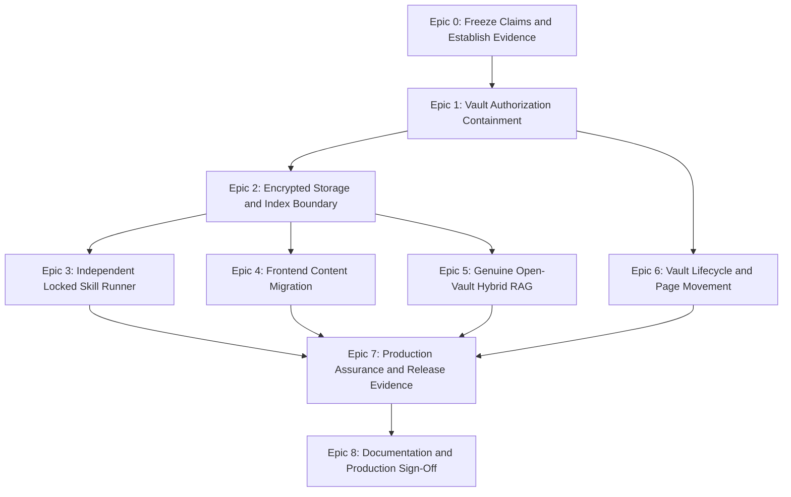

# tkxel Vault Bug Report & Remediation Plan

> **Program status:** Epic 0, Epic 1, Epic 2, Epic 3, Epic 4, Epic 5, and Epic 6 approved; Review Gate 3 explicitly approved following verified live Linux/gVisor runsc acceptance execution (25/25 checks passed); Review Gate 6 explicitly approved by the user on 2026-09-18. Epic 7 (Production Assurance and Release Evidence) is now unblocked.  
> **Created:** 2026-09-16  
> **Primary handoff:** [CODEX_MEMORY.md](./CODEX_MEMORY.md)  
> **Authority:** [AGENTS.md](./AGENTS.md), [tkxel_vault_SRS.md](./tkxel_vault_SRS.md), and [tkxel_vault_PRD.md](./tkxel_vault_PRD.md)

## 1. Purpose

This plan converts the senior-review findings and the 2026-09-16 repository audit into an executable remediation program. It supersedes the production-complete interpretation of Milestone 19. Existing implementation work is a useful starting point, but no security or compliance claim is accepted until a production-path test proves it.

The estimated Codex budget for the complete program is **400,000-500,000 tokens**, with **500,000 tokens** recommended to allow for database migrations, integration-test infrastructure, debugging, red-team cycles, and documentation reconciliation.

## 2. Non-Negotiable Release Invariants

1. Every operation is authorized for the exact requested vault, not merely for a tool name.
2. Locked-vault consumers can use only `run_skill` and `ask_vault`.
3. Locked vaults do not disclose raw content, titles, IDs, snippets, chunks, embeddings, links, filenames, paths, counts, or existence signals.
4. Page and skill content is protected at rest; no unapproved plaintext or readable content index is persisted.
5. Each vault has one unique DEK wrapped by an approved KMS provider; raw keys are never persisted or logged.
6. Production fails closed when identity, KMS, LLM, runner, or authorization dependencies are unavailable.
7. Every state-changing action and tool invocation emits an append-only audit event.
8. Acceptance evidence must exercise production modules, HTTP routes, PostgreSQL/pgvector, and rendered UI behavior.

## 3. Dependency Order

Work must stop at every epic gate. A later epic may not inherit an unverified security assumption from an earlier epic.

## 4. Epic 0 — Freeze Claims and Establish a Trustworthy Baseline

**Leads:** Orchestrator, QA/Red Team, Documentation  
**Goal:** Preserve the current worktree, expose known limitations, and create reproducible evidence.

### Chunk 0.1 — Worktree and Evidence Baseline

- [x] Capture `git status --short`, current branch/commit, runtime versions, and database migration state.
- [x] Preserve all pre-existing uncommitted changes; do not reset or overwrite them.
- [x] Run build and tests uncached and archive commands, package counts, failures, and warnings.
- [x] Classify existing tests as unit, source-inspection, component, integration, security, or end-to-end.
- [x] Record the current verified baseline in `CODEX_MEMORY.md`.

### Chunk 0.2 — Compliance Claim Freeze

- [x] Keep the SRS compliance report in `Remediation required` state.
- [x] Remove or qualify production-ready badges and 10/10 claims.
- [x] Make CI reject a production-sign-off document that lacks linked acceptance evidence.

### Review Gate 0

- [x] User approves the baseline and confirms that remediation may proceed on the dirty worktree.
- [x] No code behavior is claimed fixed solely because a source-regex or copied-logic test passes.

## 5. Epic 1 — Vault Authorization and Zero-Read Containment

**Leads:** MCP Gateway, Security/Crypto, QA/Red Team  
**Goal:** Close cross-vault and locked-vault disclosure paths before improving features.

### Chunk 1.1 — Central Vault Authorization Contract

- [x] Introduce one reusable authorization service accepting `userId`, `vaultId`, operation, vault mode, and required roles.
- [x] Remove hardcoded global-owner identities and require explicit production owner configuration.
- [x] Fail closed on missing vault context, database errors, invalid mode, or missing claims.
- [x] Return uniform `not_allowed`/`not_found` errors without resource-existence disclosure.
- [x] Set and verify PostgreSQL RLS session context for every relevant transaction.

### Chunk 1.2 — MCP Per-Vault Enforcement

- [x] Require explicit `vault_id` on every vault-scoped MCP operation.
- [x] Pass caller role context into every open and locked tool handler.
- [x] Verify the exact requested vault before calling the store.
- [x] Add vault predicates to `search`, `get_page`, `get_links`, `get_context`, and `add_note` queries.
- [x] Prevent graph traversal across vault boundaries.
- [x] Remove static default vault UUIDs from production paths.

### Chunk 1.3 — REST Locked-Vault Enforcement

- [x] Remove `consumer` access from pages, links, search, versions, timeline, audit, import, and export retrieval routes.
- [x] Confirm that locked-vault consumer content access is limited to `run_skill` and `ask_vault`; `list_skills` exposes only approved catalog metadata.
- [x] Validate vault mode independently of the role string.
- [x] Review skill-list behavior and expose only approved high-level metadata.

### Chunk 1.4 — Isolation Regression Suite

- [x] Run real HTTP requests as users assigned to Vault A against Vault B IDs and titles.
- [x] Test guessed UUIDs, aliases, page IDs, graph links, search terms, add-note calls, and error timing/body parity.
- [x] Verify immediate share revocation on the next request.
- [x] Test both REST and Streamable HTTP MCP paths against the production stores.

### Review Gate 1

- [x] Zero cross-vault reads, writes, metadata leaks, or existence oracles in the integration suite.
- [x] Locked consumers receive only the approved locked tool palette and cannot call retrieval endpoints.

## 6. Epic 2 — Encrypted Storage and Search-Index Boundary

**Leads:** Security/Crypto, Backend/RAG  
**Goal:** Establish a single documented protection boundary for bodies, chunks, embeddings, caches, and keys.

### Chunk 2.1 — ADR for Searchable Encryption Boundaries

- [x] Author an ADR defining protection rules for open-vault chunks, locked-vault chunks, lexical indexes, and embeddings.
- [x] Explicitly resolve the conflict between ciphertext-only storage and native PostgreSQL full-text/vector search.
- [x] Prohibit hosted embedding calls for locked-vault content.
- [x] Define approved client-cache behavior and key lifecycle.

### Chunk 2.2 — Server Storage Remediation

- [x] Remove plaintext body persistence from `pages.front_matter` and all compatibility write paths.
- [x] Remove or replace plaintext/readable `chunks.tsv_content` according to the accepted ADR.
- [x] Encrypt chunk text using the owning vault DEK.
- [x] Protect embeddings according to vault mode and the accepted threat model.
- [x] Fail a save/publish operation or enqueue a durable retry when required indexing fails; do not silently claim success.
- [x] Zero raw DEK buffers after the operation when practical.

### Chunk 2.3 — Browser Persistence Remediation

- [x] Stop serializing decrypted `Page.content` into plaintext `localStorage`.
- [x] Remove plaintext locked-vault caches entirely.
- [x] If offline open-vault support remains required, implement an approved encrypted cache and document its key lifecycle.
- [x] Remove cached bearer tokens from insecure persistence if the identity architecture does not explicitly approve it.

### Chunk 2.4 — Canary Ciphertext Audit

- [x] Insert unique canary content through real API routes.
- [x] Inspect raw tables, JSON fields, chunks, indexes, audit metadata, logs, browser storage, and exported artifacts.
- [x] Confirm that locked canaries cannot be discovered through search, error messages, or metadata queries.
- [x] Add the audit to CI using an ephemeral PostgreSQL/pgvector environment.

### Review Gate 2 (Approved by User 2026-09-16)

- [x] Approved ADR-017 exists and matches implementation (ADR-017 Accepted).
- [x] Raw-storage audit finds no prohibited canary content or readable locked-vault derivatives.
- [x] No plaintext client cache remains outside an explicitly accepted design.

## 7. Epic 3 — Independent Locked Skill Runner and Fail-Closed Providers

**Leads:** Runtime/Sandbox, Security/Crypto, MCP Gateway  
**Goal:** Make port 3003 a real isolated service and eliminate silent production fallbacks.

### Chunk 3.1 — Service Extraction

- [x] Move the port-3003 HTTP server into `services/skill-runner`.
- [x] Add service entry point, `dev`, `start`, readiness, and health commands.
- [x] Remove the second Express listener from `apps/api-server`.
- [x] Run the skill runner in a separate container/process with explicit resource and network policy.

### Chunk 3.2 — Authenticated Service-to-Service Contract

- [x] Define signed service identity between MCP gateway/API and runner.
- [x] Do not trust `x-user-id` as authentication.
- [x] Re-resolve or cryptographically bind user, vault, role, tool, and request expiry at the runner boundary.
- [x] Disable in-process runner fallback in production and fail closed when the runner is unavailable.

### Chunk 3.3 — Locked Execution Boundary

- [x] Load encrypted skill artifacts rather than plaintext instructions from metadata fields.
- [x] Decrypt only within the runner boundary and clean up plaintext/key buffers.
- [x] Enforce non-root execution, read-only filesystem, no host mounts, default-deny egress, CPU/memory limits, and timeout.
- [x] Ensure output sanitization and audit writes cannot disclose prompts, paths, or skill contents.

### Chunk 3.4 — LLM and KMS Production Policy

- [x] Permit mock LLM/KMS providers only through explicit test/development configuration.
- [x] Refuse production startup or return a clear unavailable state when approved providers are missing.
- [x] Never label a canned mock response as successful AI execution.
- [x] Add readiness checks for provider configuration without logging secrets.

### Review Gate 3 (Approved by User with Live WSL2/gVisor Evidence)

- [x] Docker/process inspection proves that API, gateway, and runner are separate boundaries.
- [x] Unauthenticated or tampered service calls fail.
- [x] Production-mode tests prove that mock providers and in-process fallbacks cannot activate.
- [x] Live execution of `scripts/verify-gate3-linux-acceptance.sh` on Ubuntu WSL2 with gVisor `runsc`; the user explicitly accepted this environment as sufficient Gate 3 evidence on 2026-09-18.
- [x] Production MCP/HTTP `run_skill` path parses and dispatches executable manifest helpers through `SandboxRunner`.

> **Status:** APPROVED BY USER. Live acceptance verification passed with 25/25 checks and 0 failures on Ubuntu WSL2 with registered gVisor `runsc` (release-20260914.0). On 2026-09-18, the user explicitly accepted this evidence in place of the previously preferred dedicated Linux VM/CI runner and authorized Epic 7.  
> **Current Verified Evidence:** 25/25 checks passed in `scripts/verify-gate3-linux-acceptance.sh` on Linux 6.18.33.2-microsoft-standard-WSL2 (x86_64). Verification confirmed: gVisor container kernel virtualization (`Starting gVisor... Ready!`), independent network isolation (port 3003 unreachable on host, reachable on internal bridge), non-root UID 10001:10001, read-only rootfs, `no-new-privileges:true`, cap-drop ALL, live encrypted helper execution via MCP Streamable HTTP through `SandboxRunner` with gVisor, `tmpfs` execution blocking (`noexec`), default-deny network egress (`--network none`), zero host mounts, secret isolation, PID limits, 64KB output truncation, 4s execution timeout enforcement, service-token contract and Redis replay prevention (`AUTH_REPLAY_OK`), and clean audit canary scan. Complete execution log captured in `docs/acceptance-evidence/GATE-3-LINUX-RUNSC-EVIDENCE.log`.  
> **Acceptance Artifacts:** Runbook in [`docs/runbooks/GATE_3_LINUX_RUNSC_ACCEPTANCE_RUNBOOK.md`](./docs/runbooks/GATE_3_LINUX_RUNSC_ACCEPTANCE_RUNBOOK.md); acceptance script in [`scripts/verify-gate3-linux-acceptance.sh`](./scripts/verify-gate3-linux-acceptance.sh); execution evidence log in [`docs/acceptance-evidence/GATE-3-LINUX-RUNSC-EVIDENCE.log`](./docs/acceptance-evidence/GATE-3-LINUX-RUNSC-EVIDENCE.log).

## 8. Epic 4 — Complete Frontend Content-Model Migration

**Lead:** Frontend/Graph  
**Goal:** Make `Page.content` the only live body field and prevent false-success UI behavior.

### Chunk 4.1 — Single In-Memory Body Field

- [x] Replace operational reads and writes of `front_matter.body` with `Page.content`.
- [x] Keep legacy-body handling only in an import adapter that immediately scrubs it.
- [x] Cover editor switching, autosave, publish, AI replace/append/insert, link insertion, import, export, and skill conversion.

### Chunk 4.2 — Server-Confirmed State Changes

- [x] Update vault creation and page movement locally only after a successful server response.
- [x] Surface authorization, encryption, and conflict errors to the user.
- [x] Remove fake secure-vault creation and movement fallbacks from production builds.

### Chunk 4.3 — Rendered Component Tests

- [x] Add a DOM-capable React test runner and Testing Library or equivalent (`jsdom` environment with React 18 `createRoot` and `act`).
- [x] Render the actual editor, vault switcher, import/export flows, and move dialogs.
- [x] Replace copied component state machines with imports of production code.
- [x] Retain source-inspection tests only as lint-style checks and report them separately.

### Review Gate 4 (Approved with Acceptance Evidence Repaired)

- [x] Reloading and switching notes preserves content.
- [x] Exported/imported Markdown round-trips without body loss.
- [x] Failed API mutations never produce local success state.

> **Status:** Approved with acceptance evidence repaired. Epic 5 is authorized and is now starting.  
> **Test Evidence:** Uncached monorepo suite: 298 passing across all 6 packages (113 web-app, 87 skill-runner, 38 vault-core, 37 mcp-gateway, 18 api-server, 5 types) + 4 release-claim guard tests = 302 cumulative known-passing test inventory. All 14 pure DOM-rendered React component tests pass with zero warnings; all 15 production-module unit tests pass.  
> **Invariants Enforced:** `Page.content` is the sole operational body field; `front_matter.body` handling is quarantined to `legacy-import-adapter.ts` and immediately scrubbed; local vault creation and page movement require server-confirmed HTTP 2xx before state changes occur, with errors surfaced in DOM alerts; save failures in `MarkdownEditor` suppress saved indicators and display explicit error states (`data-state="error"`); tests import production operations modules directly without code simulation.

## 9. Epic 5 — Genuine Open-Vault Hybrid RAG

**Lead:** Backend/RAG  
**Goal:** Implement accurately named lexical and semantic retrieval for open vaults without weakening locked-vault isolation.

### Chunk 5.1 — Lexical Ranking (Completed & Verified)

- [x] Replace `ILIKE` positional scoring with PostgreSQL full-text `tsvector`/`tsquery` cover-density ranking (`ts_rank_cd`).
- [x] Add safe PostgreSQL query parsing (`websearch_to_tsquery('english', query)`), title boost (+0.50), tag boost (+0.20), deterministic tie-breaking (`rank_score DESC, page_id ASC, chunk_position ASC, chunk_id ASC`), and safe metadata-only snippets (`snippet: ''`).
- [x] Preserve exact vault predicates (`p.vault_id = ${vaultId}::uuid`) in every query, with zero disclosure for locked vaults and safe handling for invalid/empty queries.

### Chunk 5.2 — Semantic Embeddings (Completed & Verified)

- [x] Configure a genuine semantic embedding provider for open vaults (`OpenAiEmbeddingProvider`).
- [x] Remove or fail-close the production fallback to deterministic hash vectors (`EmbeddingConfigurationError`).
- [x] Validate vector dimension (1536), provider identity, batching, retries, timeout, and deletion/reindex semantics.
- [x] Keep deterministic hash vectors strictly test-only and never describe them as semantic embeddings.
- [x] Ensure locked and unknown content cannot reach a hosted or local embedding API.

### Chunk 5.3 — Durable Indexing and RRF (Completed & Verified)

- [x] Make indexing transactionally consistent and fail-closed prior to database modification.
- [x] Fuse lexical and vector rankings using tested RRF semantics (`HybridSearchEngine.fuseResults`).
- [x] Accurately label search results (`hybrid`, `lexical`, `vector`) without mislabeling failed semantic lookups as hybrid.
- [x] Reindex on drafts/publish according to zero-read open/locked vault invariants.
- [x] Remove stale chunks and vectors when pages move, update, or delete.

### Chunk 5.4 — Retrieval Integration Tests and Benchmarks (Completed & Verified)

- [x] Test semantic matches without shared keywords using pgvector cosine distance (`1 - (c.embedding <=> vector)`).
- [x] Test lexical exact matches, RRF ordering, tenant filtering, updates, deletes, and reindexing.
- [x] Run against active Docker PostgreSQL + pgvector and invoke production functions.
- [x] Ensure idempotent reindexing and verify atomic rollback on provider failure.

### Review Gate 5 (Approved)

- [x] Search behavior and documentation use technically accurate terminology (`ts_rank_cd`, cosine distance, RRF).
- [x] Production-path tests demonstrate lexical rank, semantic rank, RRF, vault isolation, and zero provider construction/calls for locked vaults.
- [x] Cross-vault deletion in `reindexPage` prevented and verified by PostgreSQL regression tests.
- [x] Atomic draft and publish operations wrap page timestamps, versions, and chunks in single database transaction, with pre-transaction embedding generation and full rollback on failure.
- [x] Genuine semantic retrieval verified with lexically disjoint vocabulary ("Automobile engine servicing..." vs. "car repair timetable") proving 0 lexical matches, rank 1 semantic retrieval via pgvector cosine distance (>0.8 score), and rank 1 hybrid retrieval via RRF.
- [x] Strict fail-closed OpenAI provider response validation rejects out-of-order, duplicate, missing, negative, and non-integer indices without sorting; strictly validates `timeoutMs`, `maxRetries`, and `maxBatchSize`.
- [x] Centralized runtime validator (`validateEmbeddingBatch`) rejects batch count mismatch, missing vectors, dimensions other than 1536, and non-numeric/NaN/infinite values before any DB mutation in `saveDraft`, `publishVersion`, and `reindexPage` (with the legacy `indexChunksForPage` helper eliminated).
- [x] Accurate RRF fusion source labeling: items present only in lexical rankings are labeled `lexical`, only in vector are labeled `vector`, and present in both are labeled `hybrid`.
- [x] Opt-in 10,000-page performance benchmark script (`services/vault-core/scripts/benchmark-10k.js`) executed against live Docker PostgreSQL/pgvector, verifying p95 < 500ms (Lexical p95: 103.14ms, Semantic p95: 152.40ms, Hybrid p95: 212.13ms) and clean cascading teardown.
- [x] Database test teardown hardened to rethrow cleanup errors rather than swallow them.

> **Status:** Approved. Epic 5 is completely implemented, remediated, and verified across all 6 chunks. Review Gate 5 is approved.  

## 10. Epic 6 — Vault Lifecycle and Atomic Page Movement

**Leads:** Backend/RAG, Security/Crypto, Frontend/Graph  
**Goal:** Make vault creation and cross-vault movement transactional and cryptographically correct.

### Chunk 6.1 — Transactional Vault Creation (Approved)

- [x] Create vault row, wrapped unique DEK, owner share, and audit event in one transaction.
- [x] Avoid returning wrapped-key identifiers unless the client genuinely needs them.
- [x] Validate mode and export policy server-side.
- [x] Harden POST `/api/vaults` to normalize missing or null request bodies returning HTTP 400.
- [x] Add genuine Express HTTP integration test verifying HTTP 201, `data_key_id` omission, owner identity, database records, and HTTP 400 rejections.

### Chunk 6.2 — Atomic Page Movement (Completed & Approved)

- [x] Shared page-mutation locking contract (`lockPageForMutation`) used across `movePage`, `saveDraft`, `publishVersion`, `reindexPage`, and `deletePage`.
- [x] All chunk indexing and reindexing strictly flows through `saveDraft`, `publishVersion`, `reindexPage`, or `movePage` (for locked-to-open moves), each of which acquires the page-scoped row lock via `lockPageForMutation`.
- [x] Acquire page-scoped row-level exclusive lock (`pages FOR UPDATE`) inside transaction before authoritative reads or mutations.
- [x] Fail closed if database adapter cannot provide row-level locking; never skip security locks.
- [x] `saveDraft` rechecks `expectedUpdatedAt` after acquiring lock; resolves vault and DEK post-lock to prevent stale key commits.
- [x] Remove `_injectFailureStep` from production `MovePageOptions` API; verify rollback via database/transaction proxy fault seams.
- [x] Require sufficient roles on both source and destination with transaction-scoped queries and row-level locking (`vaults FOR SHARE`, `shares FOR SHARE`).
- [x] Re-encrypt every version and protected chunk under the destination DEK across distinct KMS keys.
- [x] Abort and roll back on any decryption/re-encryption/index failure; verified with post-mutation rollback evidence.
- [x] Rebuild destination indexes and remove source index records according to mode (locked zero-read purge vs. open fresh indexing).
- [x] Emit one complete append-only audit event.
- [x] Eliminate unlocked `indexChunksForPage` mutation path and remove unused export.
- [x] Lock vault-wide reindex mutations via `reindexVault` delegating to `reindexPage` under `lockPageForMutation`, skipping concurrently moved/deleted pages and preventing destination chunk deletion.
- [x] Add deterministic live PostgreSQL concurrency tests using controllable barriers with zero sleeps for concurrent `saveDraft`/`movePage`, `publishVersion`/`movePage`, dual `movePage`, and `reindexVault`/`movePage` operations.

### Chunk 6.3 — Cross-Vault Link Policy (Completed & Hardened)

- [x] Documented ADR-018 establishing strict vault-local link scoping (`from_page.vault_id == to_page.vault_id`) and ghost link semantics (`to_page_id = null, resolved = false`).
- [x] Refactored `LinkGraphIndexer.updateLinksForPage` and `resolveIncomingGhostLinks` to derive authoritative vault ID, title, aliases, and modes under row lock (`lockPageForMutation`) and transaction, rejecting caller vault assertions with generic `not_found` and scoping ghost link resolutions strictly within `pages.vault_id = authoritativeVaultId`.
- [x] Structural database enforcement: tracked forward database migration (`0001_add_link_graph_invariants.sql`) installs deferred constraint triggers (`DEFERRABLE INITIALLY DEFERRED`) on `links`, `pages`, and `vaults` (`trg_links_enforce_invariants`, `trg_pages_enforce_link_invariants`, `trg_vaults_enforce_link_invariants`); automatic BEFORE UPDATE trigger `trg_links_before_update_fn` converting links to ghost links on target deletion (`ON DELETE SET NULL`); table CHECK constraint `links_resolved_has_target` enforcing exact logical equivalence `resolved = (to_page_id IS NOT NULL)`.
- [x] Canonical migration runner `runMigrations` and subordinated helper `ensureLinkGraphInvariants`, with dedicated `migration` container in `docker-compose.yml`, startup dependency gating, and startup verification in `api-server`.
- [x] Moved title/alias collision preflight to run before KMS DEK unwrap (`kms.unwrapKey`), re-encryption, or database mutations, throwing generic `VaultValidationError` with zero mutations to versions, chunks, pages, links, or audit events.
- [x] Inbound source links re-resolve to matching alternative source pages or convert to ghost links.
- [x] Outbound moved links re-resolve to matching destination pages for open destinations, or are purged completely for locked destinations (ADR-017 zero-read protection).
- [x] Existing destination ghost links matching newly moved page automatically resolve to it.
- [x] Raw Markdown text in version blobs is never rewritten; links remain preserved byte-for-byte.
- [x] Production-path REST evidence in `apps/api-server/test/production-isolation-http.test.js` verifying link suppression and safe ghosting during import (22/22 api-server tests pass).
- [x] Production-path Streamable HTTP MCP evidence in `services/mcp-gateway/test/production-mcp-isolation-http.test.js` verifying real `PostgresOpenVaultStore.getLinks`, `getPage` backlinks, and `get_context` isolation (40/40 mcp-gateway tests pass).
- [x] Dedicated database provisioning test suite in `services/vault-core/test/database-provisioning.test.js` verifying fresh DB provisioning, upgraded DB provisioning, constraint existence/validation, trigger enablement, and deletion ghosting (3/3 tests pass).
- [x] Comprehensive live PostgreSQL test suite in `services/vault-core/test/cross-vault-links.test.js` (20/20 tests pass) executing `runMigrations(db)` and verifying exact ghost constraint and target deletion conversion.

### Review Gate 6 (Approved 2026-09-18)

- [x] Failure injection proves full rollback (page vault assignment, re-encrypted versions, re-encrypted chunks, and links).
- [x] Source keys cannot decrypt moved content; destination keys can.
- [x] Graph and search results expose the page and its links only in the destination vault.
- [x] Zero cross-vault resolved links exist anywhere in database tables or API responses.
- [x] Gate 3 dependency satisfied by the user's 2026-09-18 acceptance of the 25/25 WSL2 + live gVisor `runsc` evidence.

> **Status:** Explicitly approved by the user on 2026-09-18. Review Gate 3 is also approved by explicit user acceptance; Epic 7 is authorized.

## 11. Epic 7 — Production Assurance and Red-Team Evidence

**Lead:** QA/Red Team  
**Goal:** Replace simulated assurance with executable production-path evidence.
**Status:** IN PROGRESS — repairing production-path acceptance tests per senior review findings.

### Chunk 7.1 — Test Infrastructure

- [x] Export application factories for HTTP testing without starting duplicate listeners (`createApiApp`, `createGatewayApp`, `createSkillRunnerApp`).
- [x] Provision ephemeral PostgreSQL + pgvector and Redis in CI and local Docker environments.
- [x] Apply real migrations before integration tests (`runMigrations`).
- [x] Run acceptance jobs uncached against live local PostgreSQL/pgvector and Redis, while labelling external-provider protocol substitutes as contract-test doubles.

### Chunk 7.2 — Test Taxonomy Cleanup

- [x] Separate unit, source-inspection, component, integration, security, and end-to-end counts.
- [x] Replace tests that recreate auth/resolver/move/storage logic with imports of production implementations.
- [x] Keep source regex checks out of acceptance totals (`verify-release-claims.mjs` strictly disallows `mock`, `source-inspection`, `unit` in release manifest).

### Chunk 7.3 — Adversarial Acceptance Suite

- [x] Run 22 prompt-exfiltration probes against live locked endpoints (`/api/run-skill` and `/api/ask-vault`).
- [x] Run cross-user, cross-vault, revoked-user, malformed-token, and guessed-resource attacks.
- [x] Inspect raw storage and browser persistence for canaries (`scripts/verify-acceptance-criteria.js` AC-10).
- [x] Exercise provider failure, runner outage, database rollback, and index-retry paths.

### Chunk 7.4 — Acceptance Script Rebuild

- [x] Make `scripts/verify-acceptance-criteria.js` execute real production modules against live local endpoints and explicitly classify external-provider contract-test doubles.
- [x] Prevent string/file-presence checks from producing a pass.
- [x] Emit machine-readable evidence with validated commit, environment, and verifiable artifact contents.

### Review Gate 7 (Pending User Review & Explicit Approval)

- [x] Focused builds and acceptance checks pass against the active remediation commit; package-suite totals are recorded only when independently rerun.
- [x] Security acceptance evidence identifies its runtime boundaries, including contract-test doubles where external providers are simulated.
- [x] No known critical/high implementation findings remain open; `scripts/verify-release-claims.mjs` rejects production approval when evidence identifies a contract-test double.
- [ ] Attach genuine cloud-KMS and hosted-LLM smoke-test evidence before changing the manifest to `production-approved`.

> **Status:** REMEDIATION IMPLEMENTATION COMPLETE — EXTERNAL PROVIDER EVIDENCE PENDING. Review Gate 7 cannot be approved for production release until genuine cloud-KMS and hosted-LLM smoke-test evidence is attached. Epic 8 source-of-truth documentation may proceed, but its final release sign-off remains blocked on this evidence, timeline-content remediation, and explicit user sign-off.

## 12. Epic 8 — Documentation Reconciliation and Release Sign-Off

**Leads:** Documentation, Orchestrator, all domain owners  
**Goal:** Make repository documentation describe only verified behavior.

### Chunk 8.1 — Source-of-Truth Reconciliation

- [x] Update README architecture, commands, test counts, and limitations.
- [x] Update `PROJECT_MEMORY.md` milestone status and changelog.
- [x] Update SRS compliance statuses with evidence links.
- [x] Update MCP, deployment, backup, and operator runbooks.

### Chunk 8.2 — ADR and Data Dictionary Completion

- [x] Record searchable-encryption/index decision.
- [x] Record independent runner trust boundary and service-auth decision.
- [x] Document every plaintext metadata field, ciphertext field, derived index, and retention rule.

### Chunk 8.3 — Final Release Gate

- [ ] Security lead signs isolation and encryption criteria.
- [ ] Backend lead signs retrieval and migration criteria.
- [ ] Runtime lead signs runner and provider fail-closed criteria.
- [ ] Frontend lead signs content round-trip and client-persistence criteria.
- [ ] QA lead signs uncached acceptance evidence.
- [ ] User provides explicit production sign-off.

### Review Gate 8

- [ ] Only after all prior gates pass may documents say `production-ready` or `fully compliant`.

## 13. Recommended PR Boundaries

1. `security/mcp-vault-authorization`
2. `security/storage-index-boundary`
3. `runtime/independent-skill-runner`
4. `frontend/content-model-migration`
5. `search/open-vault-hybrid-rag`
6. `vault/transactional-lifecycle`
7. `qa/production-path-acceptance`
8. `docs/verified-release-reconciliation`

Each PR must include its own migration notes, rollback path, tests, and `CODEX_MEMORY.md` checkpoint update.

## 14. Definition of Program Completion

The program is complete only when all Epic 0-8 review gates are checked, the uncached acceptance suite passes against production modules and real infrastructure, the user explicitly approves the final gate, and the compliance report is updated with traceable evidence.

## 15. SRS Gap Audit — Prioritised Fix List (2026-10-09)

Source: code audit of every SRS requirement against `dev` at `342221b` (web app, backend, MCP gateway, skill runner, infra). Baseline at audit time: uncached build/typecheck/test 12/12 tasks, 444 tests passing. Items are ordered by risk, then by what blocks the SRS acceptance criteria. Effort: S = under a day, M = 1-3 days, L = a week or more.

### P0 — Security defects

- [x] **15.1** Remove the hard-coded gateway JWT secret default and the unconditional HS256 fallback; fail startup when no verifier is configured (FR-61, FR-65) — `services/mcp-gateway/src/auth/oauth.ts`, `start.ts` — S
- [x] **15.2** Make the API dev auth bypass opt-in (`ENABLE_DEV_AUTH_BYPASS === 'true'`); hide the "Local Dev" login button unless enabled (FR-50) — `apps/api-server/src/server.ts`, `apps/web-app/src/App.tsx` — S
- [x] **15.3** Restrict publish to Owners; stop import and `add_note` writing `published` versions for Editors (FR-41) — S — also fixed: import could overwrite a page belonging to another vault.
- [x] **15.4** Stop drafts reaching Readers through `/versions`, the page-list fallback, and the search index (FR-43) — M — **Partly done 2026-10-09:** `/versions`, page list, single-page read and MCP `get_page`/`get_context` now serve published snapshots only. **Open:** the search index is still built at draft save (existing Gate 5 tests pin that behaviour) and titles/tags are unversioned; needs a design decision. **Closed 2026-10-10 (decision: Readers and retrieval tools search published text only).** A page now keeps index entries for its published version while a draft is edited; a draft save replaces only the draft's entries, and publishing makes the new version the only indexed one. Reader and MCP searches match the published version only; Owner and Editor searches follow the newest. Reindex and draft import follow the same rule. One pinned test (`semantic-retrieval-lifecycle` case 37) asserted the old behaviour (all old index entries purged at draft save) and was rewritten to the new contract; this is a deliberate requirement change, not a relaxed assertion. Limit: page titles and tags are not versioned, so a rename or tag change is visible to Readers as soon as it is saved, before publish.
- [x] **15.5** Validate share roles: reject `owner`, reject `reader` on locked vaults (FR-52, FR-53) — S
- [x] **15.6** Apply `audit.sql` and `rls.sql` through a migration; connect services as a non-superuser role (FR-84, AC-6) — M — **Partly done 2026-10-09:** migration `0002_audit_append_only` installs UPDATE/DELETE/TRUNCATE triggers. **Open:** `rls.sql` is still not applied and services still connect as `postgres`; enforcing RLS needs every query to run in a transaction that sets `app.current_user_id` (larger refactor). **Closed in part 2026-10-10, with the remainder deferred by decision.** Done: services no longer need the database owner. Migration `0011` adds `tkxel_grant_app_role`; the compose stack creates the `tkxel_app` role at first start (`scripts/init-db-app-role.sh`), the migration job keeps the owner connection, and the API, gateway and runner connect as `tkxel_app`. That role can read and write rows but cannot change the schema, drop or disable the append-only triggers, or update, delete or truncate audit events. Verified by `vault-core/test/app-role-least-privilege.test.js` (a real connection as the role) and in CI, where the images boot and answer as `tkxel_app` and four destructive statements are refused. Not done: per-user row-level security. `rls.sql` is still not applied by the migrations; turning it on requires every request to carry the user identity into its database session, which is a separate refactor. Not updated: the CloudFormation stack still connects as the owner, and an existing database needs the role created by hand before `SELECT tkxel_grant_app_role('tkxel_app')`.
- [x] **15.7** Block Consumers from web-app locked-vault views; stop returning the wrapped DEK from `GET /api/vaults` (SRS 2.3, NFR-04) — S
- [x] **15.8** Stop passing skill inputs through process-global `process.env.TKXEL_SKILL_INPUT` (FR-70) — `services/skill-runner/src/orchestrator/claude-connector.ts` — S
- [x] **15.9** Restore CI (build, typecheck, test on PRs); workflows were deleted in `342221b` — S — workflow restored locally; not yet run on GitHub.

### P1 — Make core flows real (currently browser-only)

- [x] **15.10** Confirm and fix possible `[[Page]]` -> `\[\[Page\]\]` escaping on editor save; add a real editor round-trip test (FR-01, FR-03) — S-M — confirmed as a real defect with a TipTap round-trip test; fixed in `apps/web-app/src/utils/editor-markdown.ts`.
- [x] **15.11** Write the `links` table on every save and publish, not only on import (FR-10, FR-13) — M — `saveDraft`/`publishVersion` now call the existing `LinkGraphIndexer`. Links follow draft content, same open question as 15.4.
- [x] **15.12** Server-side rename updating all referencing pages and links in one transaction (FR-12, AC-2) — M — `renamePage` in vault-core; draft and publish routes call it when the title changes. Rewrites the working draft and the current published snapshot of referencing pages in place; search chunks of those pages are not re-indexed.
- [x] **15.13** Skill persistence: create/update/delete routes, encrypted storage, `SKILL.md` + `tool.json` validation at upload (FR-30-32, AC-4) — L — `apps/api-server/src/skills/skill-store.ts` plus upload/publish/source/delete routes; Editor uploads are drafts until an Owner publishes; draft skills are hidden from `run_skill`, `list_skills` and `ask_vault`. ZIP companion files are not yet sent by the web modal.
- [x] **15.14** Controlled Owner/Editor workflows for locked-vault content (page routes currently require an open vault) (FR-53) — M — **Partly done:** skills in locked vaults are now manageable by Owners/Editors. Reference pages in locked vaults still have no route. **Done 2026-10-09:** `/api/vaults/:id/locked-pages` routes (list, read, save draft, Owner publish, delete) under a new `manage_locked_content` operation; content reads are audited. `ask_vault` now answers from the vault's published reference pages, decrypted in memory per request, with verbatim runs redacted from the answer. No web UI for locked pages; a vault's reference text is capped at 60,000 characters per question with no retrieval step.
- [x] **15.15** Timeline write route with encrypted `entry_text` (FR-06, AC-10) — M — `appendTimelineEntry` + `POST /api/pages/:id/timeline`; migration `0003` adds a ciphertext check (NOT VALID, so pre-existing plaintext rows are tolerated but no new ones can be written) and an update-blocking trigger.
- [x] **15.16** Server-side audit events for save, publish, page delete, import, and the four retrieval tools; remove client-fabricated events from the viewer (FR-80, FR-81) — M — save/publish audited inside their transactions; page delete, import, rename, skills and timeline audited; gateway audits every `tools/call` and fails closed. The web app still shows optimistic local entries until the audit tab reloads from the server.
- [x] **15.17** Replace hard-coded `http://localhost:3002` client calls with `VITE_API_URL` — S

### P2 — Missing "Must" features

- [x] **15.18** Version history list, real rollback, and unpublish (FR-42, FR-44) — M — server routes `/history`, `/versions/:versionId`, `/rollback`, `/unpublish` (Owner-only for the last two). **Open:** the web app has no version-history list or unpublish button yet; its diff view is still not side-by-side. **Update:** the inspector now has a History tab with a side-by-side comparison, Restore and Unpublish (Owner only).
- [x] **15.19** Vault mode toggle route and UI, audited (FR-51) — M — `changeVaultMode` + `POST /api/vaults/:id/mode`, lock/open control in the vault menu. Unlocking rebuilds the lexical index only; vectors need a reindex.
- [x] **15.20** Server-side open-vault export (Owner only, audited, full front matter); audited denial for locked vaults (FR-56, AC-10) — M — `exportVaultArchive` + `POST /api/vaults/:id/export`; the web export button now downloads the server archive.
- [x] **15.21** Search filters (type, tag, date range) and cross-vault search (FR-20) — M — `/api/search` accepts `types`, `tags`, `from`, `to`, `vaults` and searches all readable open vaults when no vault is given; Readers and MCP tools only match published pages. **Open:** no filter controls in the web search UI.
- [x] **15.22** Front matter editing and lossless round-trip; editor `#tag` parsing; add `skill` and `other` page types (FR-01, FR-04, FR-05) — M — inspector has a YAML field for user-defined front matter, saved through the draft route and included in exports; tags are the tag list plus body `#tags` (code ignored); all eight page types are offered. Front matter is edited in the inspector, not inline in the document body.
- [x] **15.23** Vault-hosted images: upload route, encrypted storage, editor extension (FR-02) — M-L — `assets` table (migration `0006`, ciphertext only), upload and serve routes, PNG/JPEG/GIF/WebP by file signature (SVG refused), editor image button and paste/drop, export bundles images, re-key and shred cover them. The image node view and upload flow were not exercised in a real browser.
- [x] **15.24** SSO-group and org-wide sharing; Entra ID sign-in (FR-50, FR-52) — L — generic OIDC verification (`OIDC_ISSUER` / `OIDC_AUDIENCE`, covers Entra ID) in gateway and API; share principals `group:<id>` and `org:all`; group membership is taken from the token's `groups` claim at each sign-in (migration `0005`) and expires after 24h. **Open:** Google Workspace ID tokens carry no groups, so group shares need Entra or another IdP that sends them; the web share dialog was not changed to offer group or org-wide; verification was tested with locally generated keys, not against a live Entra tenant.
- [x] **15.25** Wire the Redis revocation store into gateway and API server; deprovision webhook uses it (FR-54, FR-55, AC-7, AC-8) — M — gateway uses `RedisRevocationStore` when `REDIS_URL` is set and refuses to start without it in production; the API server checks the same list on every request and fails closed in production.
- [x] **15.26** Cross-vault links with "unavailable" marking (FR-16) — M — `GET /api/pages/:id/cross-vault-links` resolves ghost links per caller at read time (nothing stored, per ADR-018); unavailable targets are indistinguishable from missing ones. Not yet shown in the web UI. **Update:** the Links tab lists unresolved links with their cross-vault status.
- [x] **15.27** Owner-only audit viewer, per-vault query, server-side CSV (FR-82) — S-M — Owner-only, per-vault SQL query with action/actor/date filters and `?format=csv` (formula-injection safe, itself audited).

### P3 — MCP gateway and Claude connector

- [x] **15.28** OAuth 2.1 + PKCE: protected-resource and authorization-server metadata, `WWW-Authenticate`, real token verification (FR-61, FR-90, FR-91) — L — **Partly done:** RFC 9728 protected-resource metadata and `WWW-Authenticate` on 401. **Open (decision):** there is still no OAuth 2.1 authorization server (authorize / token / PKCE / client registration). Google does not offer dynamic client registration, so this needs either an in-house authorization server that brokers to the corporate IdP, or an IdP product placed in front. **Closed 2026-10-10 (decision: an existing identity product in front, no hand-written authorization server).** The gateway is the OAuth resource server; any standards-compliant authorization server can front it through `OIDC_ISSUER`, `OIDC_AUDIENCE` (the gateway's `/mcp` URL) and `OAUTH_AUTHORIZATION_SERVERS`. Proven end to end in CI against Keycloak 26 (`mcp-gateway/scripts/oauth-e2e-check.mjs`, job `oauth`, 15/15): an unknown client follows the 401 to the resource metadata, discovers the authorization server, registers itself, signs a user in with authorization code + PKCE (S256) and a resource indicator, passes the consent screen, receives a token whose audience is this gateway, and calls tools with that user's vault access. Refused: wrong PKCE verifier, a vault the user cannot access, a tampered token, an ID token. Limits: Keycloak ran in development mode over plain HTTP with a test realm and a local user; connecting it to the corporate directory (Entra or Google), TLS, and its production configuration are deployment work that was not done; no real MCP client such as Claude.ai has connected yet.
- [x] **15.29** Complete Streamable HTTP: GET/SSE, session id header, protocol-version and Origin checks (FR-60) — M — version negotiation and `MCP-Protocol-Version` check, signed caller-bound `Mcp-Session-Id`, Origin validation, 202 for notifications, 405 for GET/DELETE (JSON responses only, no server-initiated SSE stream), batch and 1 MB body limits.
- [x] **15.30** Align all eight tool schemas with SRS section 5, including `ask_vault` 1,500-character cap and `timeout` / `rate_limited` error codes (FR-63, FR-64) — M — **Partly done:** all eight tools accept the SRS argument names (old names kept as aliases), return SRS-shaped `structuredContent`, enforce `max_tokens`, cap `ask_vault` at 1,500 characters and map failures to `timeout` / `rate_limited` / `invalid_input` / `not_allowed`. **Open (decision):** a vault id is still required on every call, because `exact-vault-authorization.test.js` pins "no default vault"; the SRS makes it optional, and there is no tool for Claude to discover vault ids. **Update:** a `list_vaults` tool now lets clients discover vault ids; the vault-id requirement itself is unchanged. **Closed 2026-10-10 (decision: the vault ID stays required).** An explicit vault on every call is the guard against an agent acting on the wrong vault, and `exact-vault-authorization.test.js` keeps pinning it. `list_vaults` gives clients the IDs. This is a deliberate deviation from the SRS, which makes the argument optional; the SRS should be updated to match.
- [x] **15.31** `add_note`: timeline append or `/inbox` draft, not a published page (FR-66) — S — `page_id` appends an encrypted timeline entry; otherwise a draft is saved to /inbox.
- [x] **15.32** Redis-backed rate limits; apply the 60/hr locked limit; per-vault Owner configuration (FR-67) — M — **Partly done:** limits now apply to `tools/call` only, with the 60/hr locked limit enforced separately from the 300/hr retrieval limit. **Open:** counters are still in process memory (not Redis) and there is no per-vault Owner configuration. **Done 2026-10-09:** `RedisRateLimiter` (atomic Lua sliding window, fails closed, verified against a real Redis) is used whenever `REDIS_URL` is set; Owners set per-vault limits with `PUT /api/vaults/:id/rate-limits` (migration `0007`), applied per user and per vault. No web UI for the setting.
- [x] **15.33** Enable the gVisor sandbox in the compose deployment; add a Claude request timeout; update the model id (FR-71, FR-73, FR-74) — M — **Partly done:** runner uses the official `@anthropic-ai/sdk` with a 55s x 2 timeout budget, model from `ANTHROPIC_MODEL` (default `claude-opus-5-5`), refusal handling and server-side fallback. **Open:** the gVisor sandbox is still not enabled in compose (the runner image has no Docker CLI or socket). **2026-10-09:** the sandbox runs correctly under real gVisor on this machine's Ubuntu (12/12 checks). The compose question (docker socket access for the runner vs a separate host) is still a decision. **Closed 2026-10-10 (decision: sandboxes run on a separate host).** The skill-runner image now carries only a docker client; `docker-compose.yml` passes `SANDBOX_DOCKER_HOST`, TLS verification and a read-only client certificate directory, so helper scripts start as gVisor containers on a dedicated sandbox host and the runner never has access to the daemon of the machine that holds the database. Helper code and input already travel over the docker connection (stdin and environment), so no shared filesystem is needed. Without `SANDBOX_DOCKER_HOST`, skills with helper scripts are refused in production, as before. CI checks that the runner image has the client and no local daemon socket. Not verified: an actual remote sandbox host over mutual TLS (the gVisor checks were run against a local daemon).
- [x] **15.34** Stronger output leak check covering the full instructions (FR-72, AC-5) — M — sanitizer now redacts any 8-word verbatim run from anywhere in the instructions (case, punctuation and layout insensitive) and withholds output containing base64/hex copies.

### P4 — Security and operations NFRs

- [x] **15.35** Add the AWS KMS SDK dependency; pass KMS config to api-server and gateway in compose (NFR-01) — S — `@aws-sdk/client-kms` added to vault-core; compose passes KMS and embedding settings to api-server and gateway.
- [x] **15.36** TLS termination; close public ports and world-open SSH in CloudFormation; remove the hard-coded Postgres password (NFR-03) — M — `docker-compose.tls.yml` + `docker/Caddyfile`: Caddy terminates TLS (1.2/1.3, automatic certificates, HSTS) and is the only published service (80/443); Postgres, Redis, API, gateway and web lose their host ports. CloudFormation: only 80/443 public, SSH closed unless `SshCidr` is set, encrypted root volume, HTTPS outputs, hard-coded password removed. Web bundle takes `VITE_API_URL` as a build argument (`/api` behind the proxy). Validated with `docker compose config`, `caddy validate` and a YAML parse; **not deployed to AWS**.
- [x] **15.37** Secrets manager integration (NFR-09) — M — **Done in code, not run against a cloud account.** `vault-core/src/config/secrets.ts` loads secrets into the process at start-up, before any other module reads its configuration; the API server, MCP gateway and skill runner import it first. AWS: `SECRETS_PROVIDER=aws`, `SECRETS_AWS_SECRET_IDS=<id>[,<id>]` (each secret a JSON object of NAME to value, the format the CloudFormation stack already creates). Azure: `SECRETS_PROVIDER=azure`, `SECRETS_AZURE_VAULT_URL`, `SECRETS_AZURE_SECRET_NAMES` (managed identity, or `AZURE_KEY_VAULT_TOKEN`). A failure stops start-up; values are never logged; a secret cannot change `NODE_OPTIONS`, `PATH` or the provider settings. Without `SECRETS_PROVIDER` nothing changes. Tests: `vault-core/test/secrets-loader.test.js` (4, with the cloud calls replaced by stand-ins). Limits: never called against real AWS Secrets Manager or Azure Key Vault; secrets are read once at start-up, so a rotated secret needs a service restart; the CloudFormation stack still writes a root-only `.env` at boot and was not switched to this loader; the web app container and the migration job do not use it.
- [x] **15.38** Re-keying and crypto-shredding (NFR-05) — L — `rekeyVault` / `cryptoShredVault` in vault-core with Owner-only routes `/rekey` and `/crypto-shred` (typed vault-name confirmation); migration `0004` lets a re-key rewrite timeline ciphertext only. No web UI. Annual KMS master-key rotation is a cloud-side setting, not code.
- [x] **15.39** Skill scanning before publish (NFR-07) — M — `skill-scanner.ts` blocks network calls, process spawning, dynamic code, host-secret access and prompt-injection patterns at upload; warnings are stored with the skill; rejections are audited.
- [x] **15.40** Encrypted, scheduled, off-host backups with a restore check (NFR-21, NFR-22) — M — `dr_backup.sh` encrypts in-stream with GnuPG AES-256, writes a checksum, enforces retention and can copy to S3; `dr_restore.sh` has `--verify-only`. Backup and verify were exercised against the local Postgres container; the destructive restore path and the S3 copy were not run. Scheduling is a cron entry in the runbook, not deployed.
- [x] **15.41** Anomaly alerts; 2-year audit retention (FR-83, FR-84) — M — **Done.** Gateway: `security_alert` events for >3x normal hourly volume and repeated denials, optional `SECURITY_ALERT_WEBHOOK_URL`. Web/API: every refused request is now written as an `access_denied` audit event (route pattern only, no request content) and 5 refusals in 10 minutes raise one `security_alert` per user per hour; gateway `tool_denied` events count towards the same threshold (`vault-core/src/audit/access-denials.ts`). Retention: `audit_events` is append-only and nothing purges it, so events are kept indefinitely; the operating rules are in `backup_restore_runbook.md`. Tests: `vault-core/test/access-denial-alerts.test.js`, API HTTP subtest. Limits: the volume-spike rule still covers gateway tool calls only; the webhook was never delivered to a real endpoint; retention is by design and was not observed over time.
- [x] **15.42** Break-glass with dual authorization; remove the global owner override on locked vaults (NFR-06) — L — configured administrators (`VAULT_OWNER_EMAIL`) no longer own locked vaults they do not own; access needs a break-glass request approved by a different person (vault Owner or another administrator), limited to 60 minutes by default and 240 at most, revocable, fully audited (migration `0008`, DB check enforces two people). API routes only, no web UI. Administrators still own every open vault.
- [x] **15.43** Load tests for p95 and 200-user targets; 2,000-node graph benchmark (NFR-10-13) — M — **Partly done 2026-10-09 (measured on a developer laptop, local Postgres, mock KMS, keyword search only):** (1) `benchmark-10k.js`, 10,000 pages, 20 sequential samples per mode: search p95 85 ms keyword / 149 ms semantic / 211 ms hybrid. (2) New `services/mcp-gateway/scripts/load-test-gateway.mjs`, full gateway HTTP path, 10,000 pages, 200 users x 5 requests: with 2 s between a user's requests (96 req/s) p95 was 145 ms `search` and 46 ms `get_page`, 0 failures: PASS; with all 200 users firing continuously p95 was 1.28 s `search` and 3.36 s `get_page`: FAIL, throughput ceiling about 150 req/s. Cause of the ceiling: keyword search cannot use an index (the match is over title+tags+chunk text concatenated per row), so every search scans the vault; this also puts NFR-14 (100,000 pages) at risk. Fixed along the way: gateway `get_page`/`get_links` no longer load the whole vault; DB pool raised from 10 to 20 (`DB_POOL_MAX`). **Open:** index-backed search query, `run_skill` overhead (NFR-12), 2,000-node graph frame rate (NFR-11), a run on production-sized hardware. **Follow-up 2026-10-09 (index-backed search):** migration `0009` adds GIN indexes on chunk text, page titles and tags, and `searchPages` gained an optional candidate step (`candidateIndex` / `SEARCH_CANDIDATE_INDEX=1`) proven to return identical results (`search-candidate-index-equivalence.test.js`, 63 query/filter combinations). Measured alone on 10,000 pages it took a one-page query from about 40 ms to 8 ms and left broad queries unchanged. Under the 200-user paced load test it showed **no reliable gain** (p95 157-365 ms with it, 128-470 ms without, across three alternating runs) and it was slower when table statistics were stale. It is therefore **off by default** and default search behaviour is unchanged. Also learned: load results on this laptop vary by 2x or more between identical runs, and stale statistics after a bulk insert degrade every path (p95 0.4-3 s), so the import route now runs `ANALYZE` after imports of 50+ pages. Whether the system meets NFR-13/NFR-14 is still unproven and needs a run on production-sized hardware. **Linux run 2026-10-09:** see the Linux run section. Still open: NFR-13 (200 users) fails on this laptop under Linux, hybrid search misses 500 ms, sandbox start-up is borderline for NFR-12, graph frame rate (NFR-11) not measured, and no run on production-sized hardware. **Search redesign 2026-10-10:** migration `0010` stores the searched vector (title, tags and chunk text) per chunk with a GIN index, kept current by database triggers, and the keyword query is now an index lookup; the old scan is kept as `legacyScan` and `search-candidate-index-equivalence.test.js` proves identical results over 63 query/filter combinations plus renames and tag changes. The opt-in candidate step from `0009` was removed. Measured on the developer laptop (Windows, 10,000 pages, 20 samples): keyword search p50 about 30 ms (was about 200 ms on the same data), p95 35 to 180 ms across runs; hybrid p95 180 to 470 ms. Load test corrected: the virtual users now run in a worker thread (`load-driver.mjs`), so they no longer share the gateway's event loop. With that, 200 users with 2 s think time passed in one of three identical runs (search p95 147 ms, get_page 255 ms), narrowly failed in one (get_page 522 ms) and failed badly in one (seconds), with throughput for continuous load swinging between 30 and 200 requests per second. This machine is too unstable to give a verdict; one gateway process peaks at roughly 150 to 200 requests per second when it is healthy. `get_page` now runs its four independent reads concurrently. Still open: a stable run on production-sized hardware, sandbox start-up margin (NFR-12), graph frame rate (NFR-11). **Closed 2026-10-10 on the hardware available, with a production-hardware run still recommended.** Root cause of the unstable results found: the GIN search indexes used PostgreSQL's pending list (`fastupdate`), so after any bulk insert every search scanned that list until autovacuum folded it in, and latency jumped from tens of milliseconds to seconds at random. Migration `0012` maintains the indexes at write time. A second source of noise was mine: image builds and downloads were running on the same machine during earlier measurements. Results on the developer laptop (Windows, PostgreSQL in Docker, 10,000 pages, load generator on its own thread, machine otherwise idle): NFR-10 search p95 30 to 127 ms keyword, 157 to 227 ms semantic, 188 to 203 ms hybrid (all under 500 ms). NFR-13 200 users with 2 s think time: 22 of 25 runs passed with search p95 35 to 50 ms and get_page 26 to 56 ms at the full offered 98 requests per second; 3 consecutive runs failed during one unexplained stall of the machine. Saturation (200 users firing continuously, beyond the requirement): one gateway process handles 150 to 380 requests per second, with p95 0.6 to 2.5 s; more capacity means more gateway replicas. NFR-14 100,000 pages: passes with varied content (search p95 498 ms, get_page 102 ms) and fails when every query matches 10,000 pages (1.9 s); no structural change was needed to load or query that size. NFR-12 sandbox start-up under gVisor: p95 1.7 s, 2.1 s and 3.5 s in three runs on Linux, so the 2 s budget is not reliably met for skills with helper scripts on this machine. NFR-11 graph: layout of 2,000 nodes took 2.8 to 4.9 s with the old settings; graphs above 600 nodes now use a coarser, distance-limited layout computed in slices between frames and settle in 1.4 to 2.1 s (`web-app/scripts/graph-layout-benchmark.mjs`). Frame rate while drawing was not measured (needs a visible browser), and the large-graph path was not opened in a browser because no local vault has that many notes. Not done: a run on production-sized hardware, with the real KMS and a real embedding provider in the path.

### P5 — "Should" and "Could" items

- [x] **15.44** Daily note (FR-08), per-type templates (FR-09), typed links in the UI (FR-15), graph tag/vault filters (FR-13), owner-triggered reindex route (FR-24), unresolved-link highlighting (FR-11), paste import (FR-07) — **Done, with one limit.** Sidebar: **Daily Note** button and **From template…** list. Link picker: a **Relation** list, and typing `[[works_at::` also works; links are written `[[relation::Page]]`, which the parser already reads. Graph toolbar: **Tag** filter next to Type. Editor: links to pages that do not exist are underlined in amber (`UnresolvedLinks.ts`, view-only decoration, code is skipped). Import dialog: **Or paste Markdown** (goes through the same importer as a file). Workspace menu: **Rebuild search index** for owners. Limit: there is no vault filter on the graph, because the graph shows one vault at a time (ADR-018); links into other vaults are listed in the inspector instead. Tests: `test/editor-links-ui.test.js` (4). Browser-checked read-only: tag filter, paste panel, menu item. Not exercised in a browser: inserting a typed link, running a reindex, completing a paste import.

### Browser smoke test (2026-10-09, local dev sign-in, Postgres on localhost)

Checked by loading the app in a browser: sign-in screen and dev sign-in, vault list, a locked vault's "Protected skills" view, an open vault with 55 notes, the editor, and the new sidebar controls all render. Not clicked: Daily Note, templates, History tab, image insert, mode toggle, export (each would write to or download from a real vault).

Two defects found and fixed:

- [x] **15.47** Opening any note autosaved an unchanged draft. `editor.setEditable(canEdit)` in `MarkdownEditor.tsx` made TipTap report an update, which marked the note as edited; autosave then wrote a draft 1.5 s later. Every page view by an editor or owner produced a write and an audit event. Fixed with `setEditable(canEdit, false)`. A second trigger then showed up: TipTap normalises a loaded document on its first transaction (even placing the cursor), which also counted as an edit. The editor now treats an update as an edit only when the Markdown differs from what was loaded or last saved. Confirmed in the browser that opening a note, and placing the cursor in it, send no `/draft`. The `setEditable` call pre-dates the audit fixes. Test: `test/editor-links-ui.test.js` covers the `setEditable` part; the Markdown comparison is browser-checked only.
- [x] **15.48** The web app requested pages, links and timeline for locked vaults, which the server always refuses (403). `loadVaultData` in `utils/storage.ts` no longer sends those three requests when the vault is locked. Typecheck and web tests pass; not re-observed in the browser (the app opened an open vault after the change).

- [x] **15.49** Before sign-in the app sent vault requests without a token (all answered 401, no data exposed). `App.tsx` no longer requests the vault list or vault data while signed out.

- [x] **15.50** The placeholder default vault was requested once after sign-in, before the real vault list arrived (refused with 403 for users without access to it). `App.tsx` now waits for the server's vault list before loading vault data. Confirmed in the browser: after sign-in every request is answered 200 and none goes to the placeholder vault.
- [x] **15.51** Skill ZIP upload sent only SKILL.md and tool.json; helper scripts and templates in the bundle were dropped. The web app now sends every file that sits beside or below SKILL.md (archive housekeeping entries excluded) and does not keep them in browser state; the server already validated, scanned and encrypted companion files. Tests: `web-app/test/skill-bundle-files.test.js`, API subtest in `skills-lifecycle-http.test.js` (stored encrypted, returned only through the audited source route, a credential-reading file blocks the upload). Not exercised with a real ZIP in a browser.

### Closing steps

- [x] **15.45** Re-run acceptance evidence against the final commit with the real model; update `srs_compliance_report.md` **2026-10-09:** the acceptance script is repaired and passes 10/10 on Windows and Linux; `docs/acceptance-evidence/*.json` were regenerated by that run. Still open: every run uses a stand-in for the Claude API. No Anthropic API key is configured, so nothing has been run against the real model, and `srs_compliance_report.md` is not updated. **Live model run 2026-10-10 (not Claude):** with no API key available, a development-only client was added that runs a local model CLI (`LLM_CLI_COMMAND`, here Google Antigravity `agy`; refused in production). `skill-runner/scripts/live-model-check.mjs` passed 6/6 through it: one real skill request answered correctly and five instruction-extraction attempts (direct, canary, translation, base64, role-play) leaked nothing; the model itself declined each time, so the output sanitizer was not exercised. Limits: this is an agent CLI with its own system prompt, about 45 to 160 s per call, not the Claude Messages API, so it is evidence that the live path works with a real model, not Claude acceptance evidence. Also fixed: a key in another provider's format was silently ignored; it is now accepted when `ANTHROPIC_COMPATIBLE_ENDPOINT=true`. **Closed 2026-10-10 with the stand-in model the project owner designated (Google Antigravity CLI); a Claude run is still owed before release.** The project's own 22-attack live HTTP red-team suite (`adversarial-exfiltration.test.js`, real skill-runner server, encrypted skill in PostgreSQL, service tokens, sanitizer) was run with the live model in place of the scripted one: 21 of 22 attacks passed outright (no secret marker, internal path, file name or key reference in any `run_skill` or `ask_vault` answer). The 22nd (ADV-13) failed only because the model CLI timed out after 250 s; the same attack text passed when rerun on its own. Total run time 23.5 minutes. `srs_compliance_report.md` is updated. What this does not show: behaviour of Claude itself, and the Anthropic-only request features (refusal fallback), which the stand-in never exercises.
- [ ] **15.46** Third-party penetration test (NFR-08) — external, cannot be closed in code **2026-10-09:** not a substitute, but the in-repo adversarial suites (22 exfiltration probes over HTTP, token forgery and replay, sandbox policy) pass on Linux, and the sandbox was checked under real gVisor. An independent third-party test is still required. **Internal work 2026-10-10 (does not close this item):** `api-server/test/route-auth-matrix.test.js` walks all 57 API routes read from the router itself: each refuses anonymous callers with 401, and a signed-in outsider gets no data, no success on any vault-scoped route and no server error, on both an open and a locked vault (114 requests). Together with the OAuth end-to-end check, the gVisor sandbox check, the least-privilege database role check and the live-model red-team run, the in-house evidence is as complete as it can be made here. The independent test by an outside firm remains required by NFR-08 and cannot be done from inside the project.

### Linux run (2026-10-09, Ubuntu 24.04 under WSL2 on the developer laptop)

Environment: Intel Core Ultra 7 155U, 14 logical CPUs, 15 GB, Docker 29.1 with the gVisor `runsc` runtime, Node 22 (as in the Dockerfile), PostgreSQL 16 + pgvector and Redis 7 in containers, database created from nothing by the migrations. This is not production hardware.

Defects found by running on Linux, all fixed:

- [x] **15.52** A clean `pnpm install` failed on a fresh machine: `pnpm-workspace.yaml` still had the placeholder `esbuild: set this to true or false`. This would have failed the Docker image build and CI. Set to `true`; clean install, build and migrations then succeed on Linux.
- [x] **15.53** With `REDIS_URL` set (as CI sets it), four test files in the skill runner and gateway never exited, so the suites hung. The runner's Redis connection kept the process alive. The connection is now unref'd (`skill-runner/src/service-auth.ts`); a running service is kept alive by its HTTP listener.
- [x] **15.54** Outside production, a service-token nonce recorded in the in-memory fallback while Redis was still connecting was accepted again once Redis became reachable. Production was not affected (there a Redis error rejects the request). The fallback record is now always honoured. Found by the existing replay test, which only failed with Redis configured.
- [x] **15.55** A sandbox run that hit the hard timeout left its container running: the runner killed the `docker` client, not the container (FR-74). The container is now named and killed by name. Measured before: one container left; after: none.
- [x] **15.56** The 512 MB sandbox memory limit was not enforced under gVisor: a 900 MB allocation succeeded. Adding `--memory-swap` equal to the limit enforces it (the same run is now killed, exit 137).
- [x] **15.57** The acceptance script failed AC-4 and AC-5 (8 of 10) on both Windows and Linux since the Claude client moved to the Anthropic SDK: its stand-in for the Claude API matched the URL exactly and the SDK adds a query string. The stand-in now ignores the query string. No assertion was changed.

Results after the fixes:

| Check | Result |
|---|---|
| Test suites on Linux (Redis configured) | types 5/5, vault-core 164/164, skill runner 96/96, gateway 67/67, API 57/57. Web app not run on Linux. |
| Acceptance script (AC-1 to AC-10, stand-ins for KMS, Claude and embeddings) | 10/10 on Linux and on Windows |
| gVisor sandbox (`skill-runner/scripts/sandbox-gvisor-check.mjs`) | 12/12: non-root, gVisor kernel (4.19.0-gvisor vs host 6.18), read-only root, `/tmp` writable but not executable, no network, no host variables, timeout stops and removes the container, memory limit enforced |
| Sandbox start-up under gVisor (20 runs) | p50 about 1.5 s; p95 1.7 s, 2.1 s and 3.5 s in three runs. Against the 2 s NFR-12 budget this is borderline and not reliably met on this machine. |
| Search, one user, 10,000 pages (20 samples per mode, tuned PostgreSQL) | keyword p95 241 ms, semantic 218 ms: pass. Hybrid 597 ms: fail (845 ms on default PostgreSQL settings). |
| Gateway, 50 users, 2 s between a user's requests | search p95 184 ms, get_page 70 ms: pass |
| Gateway, 200 users, 2 s between requests | search p95 1.5 to 1.9 s, get_page 3.2 to 4.2 s: fail |
| Gateway, 200 users firing continuously | search p95 3.2 to 3.7 s, get_page 8 to 10 s: fail. Throughput ceiling 50 to 77 requests per second. |

PostgreSQL tuning (2 GB shared buffers, 32 MB work memory) changed the load results very little, so the ceiling is the search query itself (it scans the vault for each search), not database settings. These figures are slower than the earlier Windows run on the same laptop, which passed 200 paced users; runs on this machine vary by more than 2x.

### Deployment checks (2026-10-10)

- CI on GitHub passed for the first time on the pushed branch (run 38053717314, pull request check).
- Production Docker images: the build was attempted twice on Ubuntu for all five targets and failed each time on package download timeouts inside the build (about 40 KB/s to the npm registry from this network), before any project code ran. A CI job (`images`) now builds all five targets on GitHub, applies migrations with the migration image, checks that production mode refuses to start without KMS and model configuration, boots the services and checks their health endpoints and that they run unprivileged. **Passed on GitHub 2026-10-10 (run 38057879759):** images build, migrate, refuse production start without configuration, boot, answer, and run as uid 10001. This is the first verified build of the production images. The full compose file, the TLS overlay and the CloudFormation stack are still unverified.
- The API server and MCP gateway images now run as the unprivileged `vault` user and start `node` directly (they previously ran as root through `pnpm`).

### Screens for server features (2026-10-10)

- [x] **15.58** Rate limits, key rotation, crypto-shred and emergency access had server routes but no screen. Owners now have **Vault settings** in the workspace menu (`VaultSettingsModal.tsx`, `operations/vault-admin-actions.ts`): per-vault rate limits with the platform defaults shown, **Rotate key now**, emergency-access requests for locked vaults (request with a reason, approve or deny by a second person, revoke), and **Destroy vault permanently**, which stays disabled until the exact vault name is typed. Tests: `web-app/test/vault-admin-actions.test.js`. Browser-checked as an Owner of an open vault: the dialog opens, limits load, the destroy button is disabled. Not exercised in a browser: saving limits, rotating a key, destroying a vault, and the emergency-access flow (each changes real data).
- [x] **15.59** The earlier fix for placeholder-vault requests (15.50) had a race on a fresh sign-in: the vault list counted as settled while signed out, so the placeholder vault was still requested once, and with denial auditing (15.41) each sign-in then wrote three `access_denied` events. Fixed in `App.tsx`; confirmed in the browser on a fresh sign-in: no request before sign-in, none to the placeholder vault, all answered 200.

- [x] **15.60** Search filters had no screen. The sidebar now has **Filters** under the search box: type, tag and "updated on or after". With search text they are sent to the server search; without it they narrow the loaded list (`utils/search-filters.ts`, `test/search-filters.test.js`). Browser-checked: choosing a tag narrowed the list from 7 notes to 1, and a search then carried `tags=` to the server.
- [x] **15.61** Locked reference pages had no screen, so `ask_vault` could only be fed through the API. Owners and Editors of a locked vault now have **Reference pages** in the workspace menu (`LockedPagesModal.tsx`): list with published and draft state, new page, edit, save draft, publish (Owners), delete with a confirm step. Content is fetched only when a page is opened for editing (the server audits that read), is held in the dialog only, never written to browser storage, and dropped on close. Browser-checked as the Owner of a locked vault: the menu item appears and the list loads. Not exercised in a browser: opening a page, saving, publishing and deleting (each reads protected content or changes data).

Every server feature in this audit now has a screen.

### In-house penetration pass (2026-10-10)

This is the project's own adversarial testing. It is recorded separately from 15.46 because it is not independent, and NFR-08 asks for an independent test.

- [x] **15.62** In-house penetration pass over the HTTP API, run against the real server and database:
  - **Outsiders** (`route-auth-matrix.test.js`): all 57 routes, read from the router itself, refuse anonymous callers; a signed-in outsider gets no data, no success on any vault-scoped route and no server error (114 requests, open and locked vault).
  - **Insiders above their role** (`insider-privilege-escalation.test.js`): for each of the 39 routes that declare required roles, a Reader, an Editor and a Consumer call every route their role is not listed for, sending a body that tries the obvious escalations (role, owner, vault, mode, export policy, publish status). 102 requests, all refused; vault settings, shares, pages and versions unchanged afterwards; no draft text reaches a Reader through any route a Reader may call.
  - **Hostile input**: SQL injection strings, NUL bytes, path traversal, template and script payloads and 5,000-character values in search text, filters and identifiers.
  - **Two defects found and fixed.** A vault or page identifier that is not a UUID made the server answer 500 instead of a refusal; it now answers `not_found`. A NUL character in a URL or JSON body reached PostgreSQL and came back as 500; such requests are now refused with 400 before any handler runs. Neither exposed data: every query involved is parameterised.
  - Not covered here: the web app in a browser (stored content rendering, session handling), denial of service, the deployed network perimeter, dependency vulnerabilities, and anything an independent tester would think of that the authors did not.

**15.46 stays open.** Everything that can be tested from inside the project has been; the remaining action is to commission an outside firm, which only the project owner can do.

### Browser click-through and first real-protocol client check (2026-10-11 to 2026-10-12)

The web suite mostly checks source text, so these defects passed it and were found only by using the app in a browser. Each has a fix and, where behaviour can be asserted, a test.

- [x] **15.63** A saved draft did not come back when a note was reopened: once a page had a published version, the page endpoints returned the published text to everyone, so an Owner's or Editor's autosaved work looked lost. Owners and Editors now receive a draft saved after the current version, with `has_unpublished_draft`; Readers still receive only published content (`vault-core/versions/index.ts`, `api-server/server.ts`). Test: `publish-draft-visibility-http.test.js`. Browser-checked, including after a key rotation.
- [x] **15.64** "Save failed" with no reason on a vault whose key cannot be unwrapped (left behind by an acceptance run under a throwaway key). The server now answers `vault_key_unavailable` and the app says the vault cannot be edited here; the acceptance script deletes its vaults when it ends. The message itself has not been seen in a browser since the unreadable vaults were removed.
- [x] **15.65** Sidebar: the open note's row was hidden by a stray style rule, folder lists were clipped by fixed-height boxes, and the create menu opened outside the sidebar. All three fixed (`Sidebar.tsx`, `shell.css`).
- [x] **15.66** Editor: the Insert menu was clipped to its first item. Fixed; Table, Image and Auto-Link moved into it; the save status and the autosave switch became one control.
- [x] **15.67** Import gave every Markdown file without a declared type the type `agent`. It is now `note` (`vault-core/markdown/importer.ts`, test in `markdown-importer.test.js`).
- [x] **15.68** Import stored only the links the client sent, so an import that sent none produced a graph with no connections. The server now derives each imported page's links from its text once the whole batch exists, as it does on save (`api-server/server.ts`). Test: `publish-draft-visibility-http.test.js` (FR-10 import case).
- [x] **15.69** The add-skill form could not be saved with its own defaults (its parameter example was in a shape the server refuses) and always showed a false "no active KMS data key" warning because the dialog was never given the current vault. Both fixed (`AddSkillModal.tsx`, `App.tsx`). Browser-checked: a skill saved in a new locked vault.
- [x] **15.70** A destroyed (crypto-shredded) vault kept its access: it stayed in the web vault list and was offered through MCP `list_vaults`. `getUserAccessibleVaults` now leaves shredded vaults out for everyone, and the vault list does too; the sealed record and its audit events remain. Tests: `vault-rekey-shred.test.js`, `publish-draft-visibility-http.test.js`.
- [x] **15.71** After destroying a vault the settings dialog stayed open and showed the next vault's destroy form. It now closes with a confirmation.
- [x] **15.72** Vault switcher: the control labelled "Open vault X" changed a locked vault to open. It now says what it does, as does its confirmation.
- [x] **15.73** Activity & Audit: the list was squeezed to a few rows by its flex container, rows repeated raw identifiers, and the filter bar broke on narrow screens. Fixed (`AuditViewer.tsx`, `audit.css`).
- [x] **15.74** Protected skills screen showed three status cards with fixed text ("Streamable HTTP Active" and so on) that did not reflect any real state. Removed.
- [x] **15.75** Reader view showed controls that do nothing for a Reader: the formatting bar, a "Draft saved" status, the Activity & Audit tab (the trail is Owner-only) and "Connect notes" in the graph. Readers now see "Read only" and none of those controls; the audit tab shows only to Owners.
- [x] **15.76** Graph: large graphs were covered in labels because every note with three or more connections counted as a hub. Hub labels are capped at the 40 most connected notes (`utils/graph-hubs.ts`, `test/graph-hubs.test.js`). The graph opens on the entire vault; the local view moved under settings.

**Checked in a browser on throwaway vaults (since destroyed):** paste-import, typed-link insertion, saving rate limits, sharing and revoking, key rotation with notes and with a skill, adding a skill, destroying a vault, a 700-note / 1,400-link graph (longest main-thread task 58 ms in one run on this laptop).

**Reader and Editor in a browser.** The login screen has a development-only field to continue as any test address (the server already accepted `test_user:` tokens when the dev bypass is on; neither exists in a production build). As a Reader: read-only, no create or edit controls. As an Editor: can edit and autosave a draft, has no Publish button, and is refused by the server on publish. The Editor's draft was not returned to the Reader. A signed-in outsider was refused.

**MCP over the real protocol.** A minimal JSON-RPC client drove `services/mcp-gateway/dist/stdio.js` as a real user: `initialize` answered protocol 2025-11-25, `tools/list` returned nine tools, `list_vaults`, `search`, `get_page` and `get_context` returned the expected content and backlinks from a three-note vault, and requests for a vault the user cannot reach answered `not_allowed`. This is a protocol check by the project's own client, not a Claude client: the Claude Code CLI on the machine was not signed in, and Claude Desktop needs a restart to load the server that was added to its configuration.

**Still not checked in a browser:** the emergency-access request form (it shows only to an administrator who is not the vault's Owner), the graph at the 2,000-note target, and the unreadable-vault message.

### First real AI client, search for plain questions, keyword-only mode (2026-10-13)

- [x] **15.77** **A real Claude client read the vault.** Claude Code, connected through the project's `.mcp.json` to `services/mcp-gateway/dist/stdio.js` as the vault Owner, was asked in a fresh session to list the vaults and say why the fictional "Atlas" programme chose a phased go-live. It listed the four vaults the user can reach with the correct mode and role for each (open vaults with the retrieval tools, the locked vault with skills and `ask_vault` only), gave the right answer, named the note it came from ("Decision: Phased Go-Live") and cited two consistent notes. It answered from the search previews without opening the page, and said so. This is one client, one user, over stdio; the Streamable HTTP endpoint with OAuth has been exercised by the project's own scripts only, and no Consumer-role or Reader-role session has been run from a real client.
- [x] **15.78** MCP `search` and `get_context` returned nothing for a question asked in plain words, because keyword search needs every word to match and no semantic search was configured. `searchPages` has an opt-in `matchAnyFallback` (used by the retrieval tools) that adds pages matching any of the words when the strict query finds too few; negated terms are never loosened and results stay inside the vault. Test: `search-candidate-index-equivalence.test.js`.
- [x] **15.79** MCP `search` snippets were only the page heading. They are now a passage of the published text around the first query word (`makeSnippet`, `test/search-snippet.test.js`); the vault key is unwrapped once per search and wiped.
- [x] **15.80** A deployment without an embedding service could not be configured: `docker-compose.yml` demanded an OpenAI key and reindexing failed without a provider. `EMBEDDING_PROVIDER=none` is now an explicit, production-valid setting for keyword search only (save, publish, reindex and search all work; a purely semantic search still fails closed), and the compose file no longer demands the OpenAI or Anthropic key. The skill runner itself still refuses to start in production without a model key. Test: `keyword-only-search-mode.test.js`.
- [x] **15.81** `postgres-rls-session.test.js` deadlocked with other test files on a 14-core Linux host (it enables row-level security, which takes exclusive table locks, while they use the same tables). It now retries on a deadlock; its assertions are unchanged. Found by `scripts/rehearsal-linux.sh`, a script that repeats the former CI checks on any Docker host against a throwaway database in its own network.

**Still true about row-level security:** the policies in `services/vault-core/src/schema/rls.sql` are applied only by that test. No migration applies them, so a database built by the migrations alone has none.

### Linux rehearsal, browser click-through of the remaining features, recovery drill (2026-10-13)

**Linux rehearsal (`scripts/rehearsal-linux.sh`, WSL2 Ubuntu 24.04, 14 cores, commit `cf7d479`).** 25 of 25 steps passed against a throwaway database in its own network. The full monorepo suite was executed there on Node 22: types 5, vault-core 175, api-server 60, mcp-gateway 70, skill-runner 98, web-app 143 (551 tests, 0 failed). All five production images built; the least-privilege role was created and refused `DELETE FROM audit_events`, `ALTER TABLE ... DISABLE TRIGGER`, `DROP TABLE` and `CREATE TABLE`; the three services booted from their images, refused anonymous callers and ran as uid 10001. OAuth 2.1 against Keycloak: 15 of 15. gVisor sandbox: 12 of 12, start-up p95 1,172 ms over 20 runs (NFR-12 target: under 2 s). Later commits were verified by the affected package suites on Windows; the rehearsal has not been repeated on them.

- [x] **15.82** In production mode with no key service and no sign-in provider, the skill runner refused to start but the API server started and would have failed on its first request. The API server and the MCP gateway now validate their production configuration at launch and list every problem (`vault-core/config/production-check.ts`, `production-config-check.test.js`). The rehearsal's own check could not tell a refusal from a service still running at its time limit; it now can.
- [x] **15.83** **Two people editing one note: the second save erased the first.** The server refused the stale save (409), but the web app answered that refusal by fetching the newer timestamp and saving again. It now retries only when the server still holds the text this editor started from; otherwise the local text stays on screen unsaved and the person is told. Browser-checked with two signed-in sessions.
- [x] **15.84** Restoring or unpublishing a version reloads the app, which dropped the person into the first vault in the list. The current vault and note are now remembered for the browser tab.
- [x] **15.85** **Emergency access could not be requested from the web app.** The request form lives in a vault's settings, and an administrator cannot open a locked vault they do not own. Administrators now have **Emergency access** in the workspace menu, fed by `GET /api/break-glass/vaults` (name and Owner only; empty for anyone else). Browser-checked end to end: request, self-approval refused, Owner approves, the vault appears for the administrator, Owner revokes, the vault disappears, and all four events are in the audit trail.
- [x] **15.86** The convert-to-skill form had the same unusable default input example as the add-skill form (15.69). Fixed.
- [x] **15.87** On a production server with no model key, the note assistant's routes answered 500. The assistant is now reported as switched off there and every other feature is unaffected (`isLlmProviderAvailable`, `ai-plugin-without-model-key.test.js`).

**Checked in a browser for the first time, no defect found:** version history, comparison and restore; timeline entries; image upload (stored and displayed); moving a note to another vault; exporting a vault (a zip holding the published notes with their front matter); reference pages in a locked vault (create, save, publish, delete, and not readable through the open-vault routes); the message for a vault whose key cannot be unwrapped; a 390 px wide screen on notes, graph and activity (no sideways scrolling); the graph with 2,000 notes and 4,000 links (drawn in full, longest main-thread task 55 ms in one run on this laptop). The scripts are in `scripts/browser-checks/`.

**Recovery drill (`scripts/recovery-drill.sh`, following `backup_restore_runbook.md`): 14 of 14.** Encrypted backup of the local database in 9 s; the archive on disk is not a readable dump; verify-only accepts it and changes nothing; a modified archive and a wrong passphrase are both rejected; restore into a scratch database in 4 s; row counts and every stored version's ciphertext match the source; the audit trail's append-only trigger is restored and still refuses deletion; a page read from the restored database through the application decrypts. This used the local stand-in key service and a small database, not production data or a real KMS.

**Looked at and not changed: row-level security.** About 140 database statements in the services run outside a transaction that sets the per-user context the policies in `rls.sql` rely on, and those policies do not model group shares, organisation-wide shares, administrators or emergency grants. Enabling them as they are would lock people out. It needs its own piece of work: every query through a user-context transaction, and policies rewritten to match the access resolver.
